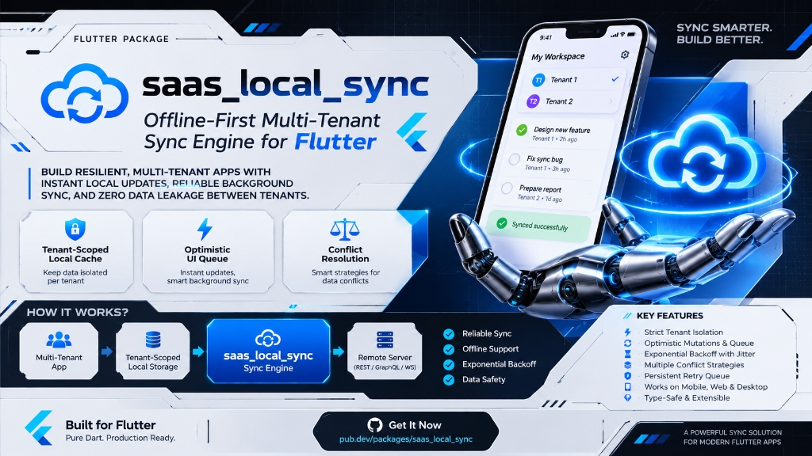
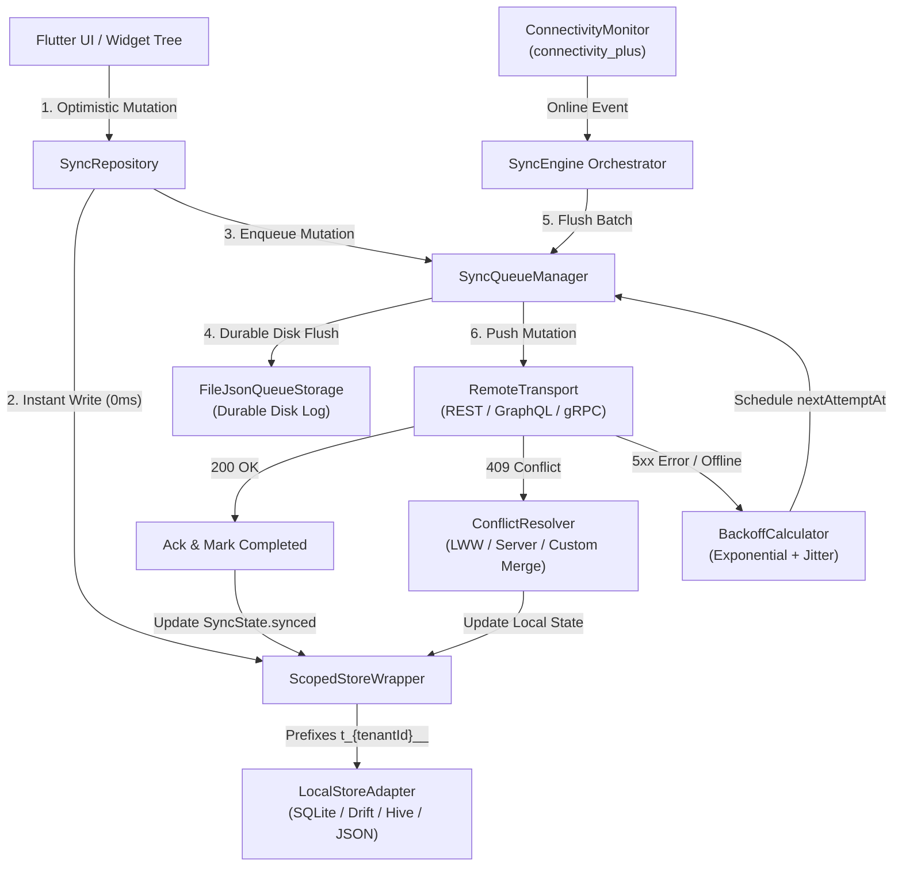

# saas_local_sync

<p align="center">
  
</p>

[](https://pub.dev/packages/saas_local_sync)
[](https://flutter.dev)
[](https://dart.dev)
[](https://opensource.org/licenses/BSD-3-Clause)

A complete, production-ready, pure-Dart, offline-first multi-tenant synchronization engine for Flutter applications.

`saas_local_sync` solves the three hardest problems in multi-tenant B2B/B2C SaaS mobile apps:
1. **Strict Tenant Isolation**: Enforces zero cross-tenant data leakage by automatically scoping local caches, queries, and queues by `tenantId`.
2. **Optimistic UI Queue**: Delivers 0ms local mutation feedback while persisting mutations to durable disk storage and processing them with exponential backoff, jitter, and dead-letter handling.
3. **Pluggable Conflict Resolution**: Provides declarative reconciliation hooks (`last-write-wins`, `server-authoritative`, `client-authoritative`, or custom multi-field merging) when offline and cloud versions diverge.

---

## 🏛️ Architecture Overview



---

## ✨ Key Features

- **Pure-Dart Core**: Synchronization logic, backoff calculation, queue persistence, and conflict merging are 100% decoupled from Flutter UI widgets. Runs seamlessly on Flutter Mobile, Desktop, Web, and Dart server-side CLI.
- **Strong Generics & Pluggable Storage**: Plug in Drift, Hive, Isar, SQLite, or the built-in `FileJsonStoreAdapter` via `LocalStoreAdapter<T>`.
- **Zero Data Leakage**: Data from Tenant A never surfaces when querying Tenant B, even after switching workspaces or clearing local state.
- **Security Hardened**: Built-in protection against tenant ID spoofing, delimiter collision (`__ts__`), directory traversal (`../`), null byte injections, and dangerous endpoint schemes.
- **Crash Recovery**: Queues are disk-backed. In-flight operations reset gracefully to `pending` upon app relaunch.
- **Exponential Backoff with Full Jitter**: Prevents "thundering herds" by dispersing retry attempts with a randomized jitter factor.
- **Loosely-Coupled Flutter Helpers**: Includes `SyncEngineNotifier`, `SyncStatusBadge`, and `EntitySyncChip` for rapid UI development.

---

## 🛡️ Security & Multi-Tenant Isolation Checks

Multi-tenant synchronization demands strict security boundaries to prevent cross-tenant data leakage or privilege escalation:

### 1. Delimiter Collision & Injection Defense
Underlying storage keys are formatted as `t_{tenantId}__ts__{key}`. If an unvalidated tenant identifier contains the prefix delimiter (`__ts__`), an attacker could craft a tenant ID that overrides or accesses another tenant's keys.
- `ScopedKey.validateTenantId(tenantId)` rejects any tenant ID containing `__ts__`.
- `ScopedKey.validateKey(key)` rejects storage keys containing `__ts__`.

### 2. Directory Traversal & Null Byte Protection
When using file-based storage or SQLite databases with tenant namespaces:
- Path traversal sequences (`..`, `/`, `\`) in tenant identifiers are strictly forbidden.
- Null byte characters (`\x00`) are blocked across all tenant identifiers, storage keys, and sync operation identifiers.
- Tenant IDs must conform to the safe character set regex `^[a-zA-Z0-9_\-\.@]+$`.

### 3. Protocol & Endpoint Protection
- `SyncOperation.validateSecurity()` inspects mutation endpoints and automatically rejects dangerous URI schemes such as `javascript:`, `file:`, or `data:`.
- Configurable `maxPayloadBytes` limits prevent memory exhaustion or disk flooding attacks.

### 4. Automated Runtime Isolation Auditing
Developers can audit their local store adapters using the built-in `TenantSecurityChecker`:

```dart
final isIsolated = await TenantSecurityChecker.auditStoreIsolation<TaskItem>(
  store: scopedStore,
  tenantA: 'tenant_acme',
  tenantB: 'tenant_globex',
  testValueA: taskA,
  testValueB: taskB,
);
assert(isIsolated, 'Tenant isolation violation detected!');
```

---

## 📦 Installation

Add `saas_local_sync` to your `pubspec.yaml`:

```yaml
dependencies:
  saas_local_sync: ^1.0.2
```

Then run:

```bash
flutter pub get
```

---

## 🚀 Quick Start Guide

### 1. Define Your Model (`SyncEntity`)

Implement `SyncEntity` on any domain class:

```dart
import 'package:saas_local_sync/saas_local_sync.dart';

class TaskItem implements SyncEntity {
  @override
  final String id;
  @override
  final String tenantId;
  final String title;
  final bool isCompleted;
  @override
  final DateTime updatedAt;
  @override
  final bool isDeleted;
  @override
  final SyncState syncState;

  const TaskItem({
    required this.id,
    required this.tenantId,
    required this.title,
    this.isCompleted = false,
    required this.updatedAt,
    this.isDeleted = false,
    this.syncState = SyncState.synced,
  });

  TaskItem copyWith({
    String? id,
    String? tenantId,
    String? title,
    bool? isCompleted,
    DateTime? updatedAt,
    bool? isDeleted,
    SyncState? syncState,
  }) {
    return TaskItem(
      id: id ?? this.id,
      tenantId: tenantId ?? this.tenantId,
      title: title ?? this.title,
      isCompleted: isCompleted ?? this.isCompleted,
      updatedAt: updatedAt ?? this.updatedAt,
      isDeleted: isDeleted ?? this.isDeleted,
      syncState: syncState ?? this.syncState,
    );
  }

  @override
  Map<String, dynamic> toJson() => {
        'id': id,
        'tenantId': tenantId,
        'title': title,
        'isCompleted': isCompleted,
        'updatedAt': updatedAt.toIso8601String(),
        'isDeleted': isDeleted,
        'syncState': syncState.toJson(),
      };

  factory TaskItem.fromJson(Map<String, dynamic> json) => TaskItem(
        id: json['id'] as String,
        tenantId: json['tenantId'] as String,
        title: json['title'] as String,
        isCompleted: json['isCompleted'] as bool? ?? false,
        updatedAt: DateTime.parse(json['updatedAt'] as String),
        isDeleted: json['isDeleted'] as bool? ?? false,
        syncState: SyncState.fromJson(json['syncState'] as String? ?? 'synced'),
      );
}
```

---

### 2. Initialize the Engine & Repositories

```dart
import 'dart:io';
import 'package:saas_local_sync/saas_local_sync.dart';

void main() async {
  // 1. Tenant Context
  final tenantScope = TenantScope('org_acme');

  // 2. Storage Adapter (In-Memory or FileJsonStoreAdapter)
  final rawStore = InMemoryStoreAdapter<TaskItem>();
  await rawStore.init();

  final scopedStore = ScopedStoreWrapper<TaskItem>(
    adapter: rawStore,
    scope: tenantScope,
  );

  // 3. Persistent Disk-Backed Queue
  final queueStorage = FileJsonQueueStorage(
    file: File('${Directory.systemTemp.path}/sync_queue.json'),
  );

  final queueManager = SyncQueueManager(
    storage: queueStorage,
    backoffCalculator: const BackoffCalculator(
      baseDelay: Duration(seconds: 1),
      maxDelay: Duration(seconds: 30),
      multiplier: 2.0,
      jitterFactor: 0.25,
    ),
    onDeadLetter: (failedOp) {
      print('Dead-lettered operation: ${failedOp.id} after max retries.');
    },
  );

  // 4. Remote Transport & Network Monitor
  final connectivity = FlutterConnectivityMonitor();
  final transport = MockRemoteTransport(); // Or your HTTP/GraphQL client

  // 5. Orchestrator Engine
  final engine = SyncEngine(
    tenantScope: tenantScope,
    queueManager: queueManager,
    connectivity: connectivity,
    transport: transport,
    options: const SyncEngineOptions(
      autoSyncOnOnline: true,
      periodicSyncInterval: Duration(seconds: 30),
    ),
  );

  // 6. Typed Repository
  final taskRepo = SyncRepository<TaskItem, String>(
    entityType: 'task',
    endpoint: '/api/v1/tasks',
    store: scopedStore,
    queueManager: queueManager,
    conflictResolver: ConflictResolver.lastWriteWins(),
    fromJson: TaskItem.fromJson,
    toJson: (t) => t.toJson(),
    withSyncState: (task, state, timestamp) => task.copyWith(
      syncState: state,
      updatedAt: timestamp,
    ),
  );

  engine.registerRepository(taskRepo);
  await engine.initialize();
}
```

---

### 3. Making Optimistic Offline Mutations

Mutations immediately write to the active tenant's local storage with `syncState = pendingUpdate` (or `pendingCreation`) and enqueue a disk-backed background sync mutation.

```dart
// Adding a task (0ms latency to UI)
await taskRepo.save(TaskItem(
  id: 'task_101',
  tenantId: tenantScope.activeTenantId,
  title: 'Draft quarterly budget',
  updatedAt: DateTime.now().toUtc(),
));

// Reading active tenant tasks (reactive Stream)
Stream<List<TaskItem>> liveTasks = taskRepo.watchAll();
```

---

### 4. Switching Active Tenants (Multi-Tenancy)

Switching tenants is instantaneous and guarantees strict data isolation:

```dart
// Switch to a different customer organization
await engine.switchTenant('org_globex');

// Data for 'org_globex' is loaded.
// Data from 'org_acme' is completely inaccessible.
final globexTasks = await taskRepo.findAll();
```

---

## ⚔️ Conflict Resolution Strategies

When local and remote entity versions diverge (e.g. an offline update collides with a server update, returning HTTP 409 Conflict), `saas_local_sync` provides 4 strategies:

### 1. Last-Write-Wins (Timestamp-based)
```dart
final resolver = ConflictResolver<TaskItem>.lastWriteWins(
  tieBreaker: ConflictStrategy.serverAuthoritative,
);
```

### 2. Server-Authoritative
```dart
final resolver = ConflictResolver<TaskItem>.serverAuthoritative();
```

### 3. Client-Authoritative
```dart
final resolver = ConflictResolver<TaskItem>.clientAuthoritative();
```

### 4. Custom Merge Callback
```dart
final resolver = ConflictResolver<TaskItem>.custom((context) {
  final local = context.localEntity;
  final remote = context.remoteEntity;

  // Merge fields intelligently
  final merged = local.copyWith(
    title: '${local.title} (Cloud: ${remote.title})',
    isCompleted: local.isCompleted || remote.isCompleted,
    description: '${local.description}\n[Remote]: ${remote.description}',
    updatedAt: DateTime.now().toUtc(),
  );

  return ConflictResolution<TaskItem>(
    resolvedEntity: merged,
    strategyUsed: ConflictStrategy.customMerge,
    needsRemotePush: true, // Pushes synthesized state back to backend
    details: 'Field-level merge applied.',
  );
});
```

---

## 📈 Exponential Backoff & Jitter

Failed network requests are backed off using randomized full jitter to prevent server overload:

$$\text{delay} = \min\left(\text{maxDelay},\, \text{baseDelay} \times \text{multiplier}^{\text{retryCount}-1}\right) \times (1 - \text{jitter} + 2 \times \text{jitter} \times \text{random})$$

```dart
const backoff = BackoffCalculator(
  baseDelay: Duration(seconds: 1),
  maxDelay: Duration(seconds: 60),
  multiplier: 2.0,
  jitterFactor: 0.25, // +/- 25% randomized window
);
```

---

## 📱 Flutter UI Widgets

Use the built-in UI components for live status indications:

```dart
// Header Sync Status Indicator
SyncStatusBadge(
  status: engine.currentStatus,
  pendingCount: engine.currentState.pendingOperationsCount,
)

// Individual Entity Sync Chip
EntitySyncChip(syncState: task.syncState)
```

---

## 🧪 Running Unit Tests

A comprehensive unit test suite covering tenant isolation, exponential backoff, conflict resolution, queue crash recovery, and security validations is included:

```bash
flutter test
```

Test breakdown:
- `test/security_checks_test.dart`: Rejection of delimiter collision, path traversal, null bytes, unsafe schemes, and payload size bounds.
- `test/tenant_scope_test.dart`: Zero-leakage multi-tenant verification, key prefixing, scoped clear.
- `test/backoff_and_queue_test.dart`: Exponential growth, jitter distribution bounds, dead-letter limits.
- `test/conflict_resolver_test.dart`: LWW, server/client authoritative, and custom merge logic.
- `test/queue_persistence_test.dart`: Real disk storage, simulated process termination, and crash recovery.
- `test/sync_engine_test.dart`: Complete end-to-end sync engine orchestration.

---

## 💻 Running the Example App

An interactive Flutter example application is located in the `example/` folder:

```bash
cd example
flutter run
```

Features demonstrated live:
1. **Switching Tenants**: Toggle between *Acme Corp* and *Globex Inc* to observe zero data leakage.
2. **Offline Mutations**: Turn off the in-app connectivity switch, add or edit tasks, and see instant optimistic UI updates with "Offline" badges.
3. **Background Queue Flush**: Turn connectivity back on and watch the queue flush with live animations and state transitions.
4. **Triggering Conflicts**: Tap "Test Conflict" on any task to arm a conflicting remote cloud state, then sync to see conflict resolution in action.

---

## 📄 License

This project is licensed under the BSD-3-Clause License — see the [LICENSE](LICENSE) file for details.
